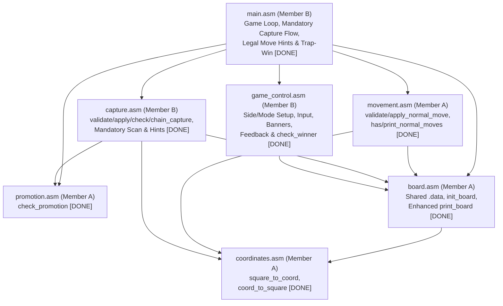
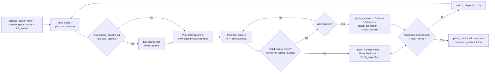

# CO2008 Checkers (MIPS Assembly) — Complete Project Walkthrough

> **Purpose of this document:** A clear, ground-up explanation of everything built in this repository from the first commit to the current state. It walks through each teammate's turn in chronological order, explains **what** the code does, **how** it works at the MIPS instruction and register level, and **why** each architectural decision was made.
>
> This guide is designed both for onboarding/reviewing each other's code and for preparing the final report and presentation.

---

## Table of Contents

1. [Project Big Picture & Team Ownership](#1-project-big-picture--team-ownership)
2. [Core Mental Model: Board, Encoding & Coordinate Math](#2-core-mental-model-board-encoding--coordinate-math)
3. [System Architecture & Module Dependency Map](#3-system-architecture--module-dependency-map)
4. [Chronological Turn-by-Turn History](#4-chronological-turn-by-turn-history)
   - [Turn 1 — Đức (Member A): Repository Bootstrap](#turn-1--đức-member-a-repository-bootstrap)
   - [Turn 2 — Quang (Member B): Architecture, Contracts & Starter Skeleton](#turn-2--quang-member-b-architecture-contracts--starter-skeleton)
   - [Turn 3 — Đức (Member A): Board State, Display & Coordinate Math](#turn-3--đức-member-a-board-state-display--coordinate-math)
   - [Turn 4 — Quang (Member B): Code Review Fix + Full Capture Engine & Winner Check](#turn-4--quang-member-b-code-review-fix--full-capture-engine--winner-check)
   - [Turn 5 — Đức (Member A): Normal Movement Rules & Execution](#turn-5--đức-member-a-normal-movement-rules--execution)
   - [Turn 6 — Quang (Member B): Main Game Loop & Turn Helpers](#turn-6--quang-member-b-main-game-loop--turn-helpers)
   - [Turn 7 — Đức (Member A): Pawn Promotion](#turn-7--đức-member-a-pawn-promotion)
   - [Turn 8 — Extra Features & Polish (QoL + Advanced Ruleset)](#turn-8--extra-features--polish-qol--advanced-ruleset)
5. [Quick Reference: Procedure Interface & Stack Summary](#5-quick-reference-procedure-interface--stack-summary)
6. [Test Suite Overview](#6-test-suite-overview)
7. [Current Project Status](#7-current-project-status)

---

## 1. Project Big Picture & Team Ownership

| Role | Team Member | Student ID | Owned Modules | Core Responsibilities |
|---|---|---|---|---|
| **Member A** | Nguyễn Tuấn Đức | `2550036` | `src/board.asm`, `src/coordinates.asm`, `src/movement.asm`, `src/promotion.asm` | Board memory & display, 1–32 ↔ `(row, col)` math, normal moves (pawn & king), promotion |
| **Member B** | Nguyễn Dương Thiều Quang | `2550206` | `src/capture.asm`, `src/game_control.asm`, `src/main.asm` | Capture validation, capture execution, follow-up & chain captures, winner detection, main game loop |
| **Shared** | Both | — | `plan.md`, `PROJECT_SETUP.md`, `tests/` | Interface contracts, unit tests, integration, report & presentation |

### Why split the project this way?
The game naturally separates into two halves connected by a small, clean interface:
* **Geometry & Basic State (Member A):** Knows *how* the board is stored, *how* to print it, *how* square numbers map to `(row, col)`, and *how* normal 1-step moves and promotions work.
* **Rules Engine & Control Flow (Member B):** Uses Member A's shared `board` array and coordinate conversion functions to implement 2-step jumps, mandatory chain captures, win detection, and the interactive turn loop.

---

## 2. Core Mental Model: Board, Encoding & Coordinate Math

Before reading any `.asm` file, keep these four conventions in mind — **every single file in `src/` depends on them.**

### 2.1. Piece & Player Codes

| Byte Value in `board` | Meaning | Display Char | Owner (`current_player`) | Movement Direction (`d_row`) |
|---:|---|:---:|---|---|
| `0` | Empty playable square | `'0'` | None | — |
| `1` | Red pawn | `'r'` | `1` (Red) | Down only (`+1` move, `+2` capture) |
| `2` | Red king | `'R'` | `1` (Red) | Up or Down (`±1` move, `±2` capture) |
| `3` | Black pawn | `'b'` | `3` (Black — moves first) | Up only (`-1` move, `-2` capture) |
| `4` | Black king | `'B'` | `3` (Black) | Up or Down (`±1` move, `±2` capture) |

* Non-playable light squares are **not stored in memory at all**; they are synthesized when printing the 8×8 grid.

### 2.2. How the 32 Playable Squares Map to the 8×8 Board

Player-facing squares are numbered **`1..32`**, stored in `board[0..31]` using **`index = square - 1`**:

```text
          col 0   col 1   col 2   col 3   col 4   col 5   col 6   col 7
row 0  |   .   |  01 r |   .   |  02 r |   .   |  03 r |   .   |  04 r |  <- Red start / Black promotion row
row 1  |  05 r |   .   |  06 r |   .   |  07 r |   .   |  08 r |   .   |  <- Red start
row 2  |   .   |  09 r |   .   |  10 r |   .   |  11 r |   .   |  12 r |  <- Red start
row 3  |  13 0 |   .   |  14 0 |   .   |  15 0 |   .   |  16 0 |   .   |  <- Empty middle
row 4  |   .   |  17 0 |   .   |  18 0 |   .   |  19 0 |   .   |  20 0 |  <- Empty middle
row 5  |  21 b |   .   |  22 b |   .   |  23 b |   .   |  24 b |   .   |  <- Black start
row 6  |   .   |  25 b |   .   |  26 b |   .   |  27 b |   .   |  28 b |  <- Black start
row 7  |  29 b |   .   |  30 b |   .   |  31 b |   .   |  32 b |   .   |  <- Black start / Red promotion row
```

Notice the mathematical properties that make everything clean:
1. A cell `(row, col)` is a **dark (playable) square** if and only if `(row + col) % 2 == 1`.
2. **Even rows (`0, 2, 4, 6`)** place dark squares on **odd columns** (`1, 3, 5, 7`).
3. **Odd rows (`1, 3, 5, 7`)** place dark squares on **even columns** (`0, 2, 4, 6`).
4. Therefore:
   * `square → (row, col)`:
     * `idx = square - 1`
     * `row = idx / 4` (MIPS: `srl` by 2)
     * `col = 2 * (idx % 4) + 1 - (row % 2)`
   * `(row, col) → square`:
     * `square = 4 * row + (col / 2) + 1` (MIPS: `(row << 2) + (col >> 1) + 1`)

### 2.3. The Golden Rule of State Mutation
* **Validators (`validate_normal_move`, `validate_capture`, `check_capture`, `check_winner`) are strictly read-only.** They must *never* write a single byte to `board`.
* **Appliers (`apply_normal_move`, `apply_capture`, `check_promotion`) mutate `board`.**

---

## 3. System Architecture & Module Dependency Map



### Turn Lifecycle (Implemented in `src/main.asm`)



---

## 4. Chronological Turn-by-Turn History

Below is the exact evolution of the repository from the first commit to the most recent commit.

---

### Turn 1 — Đức (Member A): Repository Bootstrap
* **Date:** Nov 18, 2026
* **Commits:** `82d250c` (*Initial commit*), `3de4d7e` (*Add initial content to README.m*)
* **Files added:** `CA_Assignment_261.pdf`, `README.md`

**What was done & why:**
Đức initialized the repository with the official assignment specification (`CA_Assignment_261.pdf`) and a starter `README.md`, establishing the shared source of truth for the ruleset before planning began.

---

### Turn 2 — Quang (Member B): Architecture, Contracts & Starter Skeleton
* **Date:** Nov 19–20, 2026
* **Commits:** `b425af8`, `edbb7ed` (*Plan for assignment*), `6a7a941`, `a90b68f`, `bdff6d2` (*Initialize Checkers project structure*), `eacb4c5`
* **Files added:** `plan.md`, `PROJECT_SETUP.md`, `tests/test_cases.md`, and starter stubs for all 7 files in `src/`.

**Thought process — Why invest time in scaffolding first?**
In MIPS Assembly, there are no header files, type checkers, or namespaces. If two developers write assembly independently without agreeing on exact register contracts, piece codes, and `.globl` symbol ownership, merging later becomes a nightmare of register corruption and duplicate label errors.

**Key problems solved upfront in this turn:**
1. **Single ownership of global `.data`:** `src/board.asm` was designated the *only* file that defines `board`, `current_player`, `start_square`, `destination`, and `game_over` (all exported with `.globl`). Every other file simply references them with `la`.
2. **MARS 4.5 multi-file constraint:** Although `plan.md` originally illustrated a `modules/` subfolder, `PROJECT_SETUP.md` noted that MARS's *"Assemble all files in directory"* feature does **not** recurse into subdirectories. Placing all `.asm` files flat inside `src/` ensures MARS links the entire program with a single `F3` press.
3. **MIPS Calling Convention Contract:**
   * `$a0–$a3`: arguments in
   * `$v0–$v1`: return values out
   * `$t0–$t9`: caller-saved temporaries (never assume they survive a `jal`)
   * `$s0–$s7`, `$ra`, `$sp`: callee-saved (must be pushed/popped on stack whenever modified or when making nested `jal` calls)
4. **Milestone plan & test checklist:** Defined 6 integration milestones and 13 essential test scenarios in `tests/test_cases.md` so each member could validate their modules independently before integration.

---

### Turn 3 — Đức (Member A): Board State, Display & Coordinate Math
* **Date:** Nov 20, 2026
* **Commits:** `f3b7b89` (*Initialize board, design coordinate for black and red*), merged via `a637625`
* **Files implemented:** `src/board.asm`, `src/coordinates.asm`, `src/board.md`, `src/coordinates.md`, `tests/test_member_a.asm`, plus a temporary hook in `src/main.asm`.

This turn completed **Milestones 1 & 2** — the foundational layer that Member B's capture logic depends on.

#### A. Shared Data in `src/board.asm` (lines 1–16)
```mips
.data
.align 2
.globl board
board: .space 32              # 32 bytes for playable squares 1..32

.globl current_player
current_player: .word 3       # Black (3) moves first per assignment spec
.globl start_square
start_square:   .word 0
.globl destination
destination:    .word 0
.globl game_over
game_over:      .word 0
```
* **Why `.align 2`?** Ensures word-aligned memory (`4`-byte boundary) so `current_player` and subsequent `.word` globals never trigger an unaligned-word exception in MARS (and `32` bytes is already a multiple of 4).

#### B. `init_board` in `src/board.asm` (lines 20–52)
* **What it does:** Initializes `board[0..31]` to standard Checkers starting positions:
  * `i = 0..11` (squares `1..12`) → `1` (Red pawn)
  * `i = 12..19` (squares `13..20`) → `0` (Empty)
  * `i = 20..31` (squares `21..32`) → `3` (Black pawn)
* **Register & Stack Design:** Leaf procedure (no `jal`), uses only `$t0` (base address), `$t1` (index `i`), `$t2` (comparison / piece code), `$t3` (`&board[i]`). No stack frame needed. Uses `sb` (store byte) because each square occupies 1 byte.

#### C. `square_to_coord` in `src/coordinates.asm` (lines 5–26)
* **Signature:** `$a0 = square (1..32)` → `$v0 = row (0..7)`, `$v1 = col (0..7)` (or `-1, -1` if invalid).
* **How the bit-level math works:**
  1. Bounds guard: rejects `$a0 < 1` or `$a0 > 32` (`slti` against `1` and `33`).
  2. `idx = square - 1` (`addi $t0, $a0, -1`)
  3. `row = idx / 4` → `srl $v0, $t0, 2`
  4. `rem = idx % 4` → `andi $t1, $t0, 3`
  5. `row_parity = row % 2` → `andi $t2, $v0, 1`
  6. `col = (rem << 1) + 1 - row_parity` (`sll`, `addi +1`, `subu`)
* **Thought process:** Replacing `div`/`mul` with `srl`/`sll`/`andi` avoids `HI`/`LO` registers, runs in single cycles, and avoids a branch for even vs. odd rows by simply subtracting `row_parity`.

#### D. `coord_to_square` in `src/coordinates.asm` (lines 29–54)
* **Signature:** `$a0 = row`, `$a1 = col` → `$v0 = square (1..32)`, or `-1` if invalid.
* **Checks performed:**
  1. `0 <= row <= 7` (`bltz` + `slti ..., 8`)
  2. `0 <= col <= 7` (`bltz` + `slti ..., 8`)
  3. Playable dark square: `((row + col) & 1) == 1`. If `0`, returns `-1`.
* **Formula:** `(row << 2) + (col >> 1) + 1`.
* **Why returning `-1` matters:** Callers like `check_capture` can generate candidate `(row ± 2, col ± 2)` pairs without doing any bounds math themselves — a single `bltz $v0` rejects both off-board coordinates and light squares automatically.

#### E. `print_board` in `src/board.asm` (lines 56–162)
* **What it does:** Renders the full 8×8 board to the MARS console using syscall `11` (`print_character`).
* **Stack & Register Design:** Non-leaf procedure (calls `coord_to_square`), so it allocates a **16-byte stack frame** saving `$s0` (`row`), `$s1` (`col`), `$s2` (`board` base address), and `$ra`.
* **Walkthrough:**
  1. Outer loop `$s0 = 0..7`, inner loop `$s1 = 0..7`.
  2. Computes `(row + col) & 1`. If `0` (light square), prints inaccessible marker (`'_'`, ASCII `95`) without ever touching `board`.
  3. If `1` (dark square), calls `coord_to_square($s0, $s1)`, defensively checks `1 <= $v0 <= 32` (prints `'?'` if corrupted), loads `board[$v0 - 1]` with `lb`, and branches to map `0 → '0'`, `1 → 'r'`, `2 → 'R'`, `3 → 'b'`, `4 → 'B'`.
  4. Prints a space `' '` after columns `0..6` and `'\n'` after column `7`.

#### F. `tests/test_member_a.asm`
Verifies `init_board` + `print_board` visually, then exhaustively loops `s = 1..32` checking that `coord_to_square(square_to_coord(s)) == s` (the **round-trip bijection test**).

---

### Turn 4 — Quang (Member B): Code Review Fix + Full Capture Engine & Winner Check
* **Date:** Nov 21, 2026
* **Commits:**
  * `13958c7` (*Fix board display and Member A test harness*)
  * `f03512f` (*Complete capture and game control modules*)
* **Files changed/added:** `src/board.asm`, `tests/test_member_a.asm`, `src/capture.asm` (992 lines), `src/capture.md`, `src/game_control.asm` (138 lines), `plan.md`, and 5 test harnesses in `tests/`.

#### Part 4A — Peer Review & Cleanup (`13958c7`)
When Quang pulled Đức's code to start building capture logic on top of it, he caught and fixed three practical issues:
1. Removed duplicate `.data` declarations (`board`, `current_player`, etc.) in `tests/test_member_a.asm` because `.include "../src/board.asm"` already defines them.
2. Fixed `.include "../modules/..."` paths in `tests/test_member_a.asm` to `"../src/..."`.
3. Changed `print_inaccessible` in `src/board.asm` from `'_'` (`95`) to `'-'` (`45`) to match the assignment PDF's illustrated output *(later reverted by Turn 5 — see Section 7)*.

#### Part 4B — The Capture Module (`src/capture.asm`)
This module implements all four capture procedures in a layered, composable design:

```text
chain_capture  ──►  check_capture  ──►  validate_capture  ──►  square_to_coord / coord_to_square
      │                                        ▲
      ├──────────►  apply_capture  ────────────┘
      └──────────►  check_promotion (Member A)
```

##### 1. `validate_capture` (`src/capture.asm`, lines 20–326)
* **Signature:** `$a0 = start`, `$a1 = destination`, `$a2 = current_player` → `$v0 = 1` (valid) or `0` (invalid). **Strictly read-only.**
* **Stack frame (40 bytes):** Saves `$s0–$s7` and `$ra`:
  * `$s0` = start square, `$s1` = dest square, `$s2` = current player, `$s3` = piece at start
  * `$s4, $s5` = `(r1, c1)` start coordinates
  * `$s6, $s7` = `(r2, c2)` destination coordinates
* **The 6-Stage Validation Pipeline:**
  1. **Range check:** `start ∈ 1..32` and `dest ∈ 1..32`.
  2. **Player & Ownership check:** `current_player` must be `1` or `3`. Loads `board[start - 1]` with `lbu` and confirms it belongs to that player (`1, 2` for Red; `3, 4` for Black).
  3. **Empty landing square:** Loads `board[dest - 1]` and requires `== 0`.
  4. **2-Square Diagonal Geometry:** Calls `square_to_coord(start)` and `square_to_coord(dest)`. Computes `d_row = r2 - r1`, `d_col = c2 - c1`. Requires `d_row ∈ {+2, -2}` and `d_col ∈ {+2, -2}`.
  5. **Direction Rule (Pawn vs. King):**
     * Red pawn (`1`) → requires `d_row == +2` (downward)
     * Black pawn (`3`) → requires `d_row == -2` (upward)
     * Kings (`2, 4`) → skip check (both directions allowed)
  6. **Midpoint & Opponent Check:**
     * Computes `mid_row = (r1 + r2) >> 1` and `mid_col = (c1 + c2) >> 1`.
     * Calls `coord_to_square(mid_row, mid_col)` (rejects if `< 0`).
     * Loads `mid_piece = board[mid_sq - 1]`. Rejects if `0` (empty) or friendly; accepts **only** if opponent (`3` or `4` when Red jumps; `1` or `2` when Black jumps).
* **Thought process:** Computing the jumped square in 2D coordinate space via midpoint averaging `(r1 + r2)/2, (c1 + c2)/2` avoids all the error-prone `+4/+5/-4/-3` offset quirks of 1–32 Checkers numbering.

##### 2. `apply_capture` (`src/capture.asm`, lines 352–507)
* **Signature:** `$a0 = start`, `$a1 = destination` (reads global `current_player`) → `$v0 = 1` (success) or `0` (failed).
* **Stack frame (32 bytes):** Saves `$s0–$s5` and `$ra`.
* **How it works:**
  1. **Self-validates first:** Loads `current_player` and calls `validate_capture($a0, $a1, current_player)`. If `0`, returns `0` immediately — guaranteeing `board` is untouched on any invalid input.
  2. Reads moving piece `board[start - 1]` into `$s2`.
  3. Recomputes the middle square via `square_to_coord` + midpoint average + `coord_to_square`, saving it in `$s5`.
  4. Performs **3 atomic byte writes**:
     * `sb $zero` to `board[start - 1]` (vacate start)
     * `sb $zero` to `board[mid - 1]` (remove captured opponent)
     * `sb $s2` to `board[dest - 1]` (land moving piece)
  5. Returns `$v0 = 1`.

##### 3. `check_capture` (`src/capture.asm`, lines 530–792)
* **Signature:** `$a0 = current_square` (reads global `current_player`) → `$v0 = 1` if at least one legal capture exists from this square, else `0`. **Strictly read-only.**
* **Stack frame (40 bytes):** Saves `$s0–$s7` and `$ra`:
  * `$s0` = current square, `$s1` = `current_player`, `$s2` = piece (reused for candidate square)
  * `$s3, $s4` = `(row, col)` of current square
  * `$s5` = current `row_dir` (`+2` or `-2`)
  * `$s6` = current `col_dir` (`-2`, then `+2`)
  * `$s7` = number of row directions to test (`1` for pawns, `2` for kings)
* **How it works:**
  1. Validates `current_square ∈ 1..32` and loads `piece = board[current_square - 1]`.
  2. Sets search directions by piece type:
     * Red pawn → `row_dir = +2`, count `1` (tests 2 diagonals: down-left, down-right)
     * Black pawn → `row_dir = -2`, count `1` (tests 2 diagonals: up-left, up-right)
     * Any King → `row_dir = -2`, count `2` (tests all 4 diagonals: up-left, up-right, then switches `row_dir = +2` for down-left, down-right)
  3. For each candidate `(row + row_dir, col + col_dir)`:
     * Calls `coord_to_square`. If `< 0` (off board), skips to next direction.
     * Calls `validate_capture(current_sq, candidate_sq, current_player)`.
     * **Short-circuits** immediately with `$v0 = 1` as soon as one legal capture is found.
* **Thought process:** Reusing `validate_capture` as the oracle guarantees that `check_capture` and `validate_capture` can never disagree on legality.

##### 4. `chain_capture` (`src/capture.asm`, lines 824–992)
* **Signature:** `$a0 = current_square` (called *after* the initial capture and its promotion check) → `$v0 = 1` (chain completed) or `0` (invalid initial state).
* **Stack frame (16 bytes):** Saves `$s0` (`current_sq`), `$s1` (`current_player`), `$s2` (user-entered destination), `$ra`.
* **Interactive Loop:**
  1. Validates initial `current_sq ∈ 1..32` and `current_player ∈ {1, 3}`.
  2. Calls `check_capture($s0)`. If `0`, prints `"No further capture available. Chain complete.\n"` and returns `1`.
  3. Prompts `"Chaining possible. Enter landing square: "` (`syscall 4`) and reads an integer (`syscall 5`) into `$s2`.
  4. Calls `apply_capture($s0, $s2)`.
     * If `0` (bad input / illegal jump) → prints `"Not a valid capture! Try another landing square.\n"` and loops back to step 3. Neither `board` nor `current_player` changes.
  5. Moves `$s0 = $s2` (the piece is now at the new square).
  6. **Calls `check_promotion($s0)` immediately** — before looping back to step 2 (`check_capture`).
* **Why step 6 is crucial:** Per the Checkers assignment rules, if a pawn lands on its promotion row mid-chain, it becomes a King *immediately* and can continue capturing **backwards** on the very next hop of the same turn. Calling `check_promotion` before `check_capture` makes that work automatically.

#### Part 4C — Winner Detection (`src/game_control.asm`)
##### `check_winner` (`src/game_control.asm`, lines 33–138)
* **Signature:** `$a0 = player_to_check` (`1` = Red, `3` = Black) →
  * `$v0 = 1`: player has **0 remaining pieces** (eliminated — the other player wins!)
  * `$v0 = 0`: player still has at least one piece
  * `$v0 = -1`: invalid player argument
* **How it works:** Leaf procedure (no stack). Sets `$t5, $t6` to the player's pawn & king codes (`1, 2` for Red; `3, 4` for Black), walks `board[0..31]` with `lbu`, returns `0` immediately on the first match, or `1` if all 32 bytes contain none of that player's pieces.

---

### Turn 5 — Đức (Member A): Normal Movement Rules & Execution
* **Date:** Nov 22, 2026
* **Commit:** `4ecea24` (*update board and generate movement rules and step.*)
* **Files changed/added:** `src/movement.asm`, `src/movement.md`, `src/board.asm`, `src/main.asm`.

This turn completed **Milestone 3** and King movement from **Milestone 4**.

#### 1. `validate_normal_move` (`src/movement.asm`, lines 3–118)
* **Signature:** `$a0 = start`, `$a1 = destination`, `$a2 = current_player` → `$v0 = 1` (valid) or `0` (invalid). **Strictly read-only.**
* **Stack frame (24 bytes):** Saves `$s0–$s4` and `$ra`:
  * `$s0` = start square, `$s1` = dest square, `$s2` = piece at start
  * `$s3, $s4` = `(r1, c1)` start coordinates
* **The 6-Stage Validation Pipeline:**
  1. **Range check:** `start ∈ 1..32` and `dest ∈ 1..32`.
  2. **Ownership check:** Loads `board[start - 1]` into `$s2`; verifies `current_player == 1` owns `1` or `2`, and `current_player == 3` owns `3` or `4`.
  3. **Empty destination:** Verifies `board[dest - 1] == 0`.
  4. **Coordinate conversion:** Calls `square_to_coord(start)` → `($s3, $s4)` and `square_to_coord(dest)` → `($v0, $v1)`. Computes `d_row = r2 - r1` (`$t0`) and `d_col = c2 - c1` (`$t1`).
  5. **Horizontal distance:** Requires `d_col == +1` or `-1` (one column diagonally).
  6. **Vertical direction (Pawn vs. King):**
     * Red pawn (`1`) → requires `d_row == +1` (down)
     * Black pawn (`3`) → requires `d_row == -1` (up)
     * Kings (`2` or `4`) → requires `d_row == +1` or `-1` (both directions)
* **Thought process:** Follows the exact same defensive pattern and register discipline as `validate_capture`, making the two validators symmetric and easy to maintain.

#### 2. `apply_normal_move` (`src/movement.asm`, lines 121–145)
* **Signature:** `$a0 = start`, `$a1 = destination` (no return value).
* **How it works:** Leaf procedure (no stack, uses `$t0–$t3`). Guards `start, dest ∈ 1..32`, reads `piece = board[start - 1]`, writes `piece` to `board[dest - 1]`, and writes `$zero` to `board[start - 1]`.

---

### Turn 6 — Quang (Member B): Main Game Loop & Turn Helpers
* **Commit:** `efb5901` (*Complete main game loop, turn helpers, and Member B doc updates*)
* **Files updated:** `src/main.asm`, `src/game_control.asm`, `src/capture.md`, `plan.md`

Connected all modules into a playable turn loop: added `print_turn_banner`, `read_player_move`, `switch_player`, and `announce_winner` in `src/game_control.asm`, wired the normal-move → capture → chain-capture → winner-check cycle in `src/main.asm`, and fixed the stale `check_capture` doc comment.

---

### Turn 7 — Đức (Member A): Pawn Promotion
* **Commit:** `0a876fa` (*check promotion*)
* **Files updated:** `src/promotion.asm`, `src/promotion.md`

Implemented `check_promotion($a0 = destination)` as a fast leaf procedure (no stack needed):
* Rejects squares outside `1..32`.
* Red pawn (`1`) on squares `29..32` (bottom row) → promoted to Red King (`2`).
* Black pawn (`3`) on squares `1..4` (top row) → promoted to Black King (`4`).
* Everything else (empty, already King, or middle rows) is left untouched.

Because `main.asm` and `chain_capture` both call `check_promotion` right after moving/jumping and *before* `check_capture`, a pawn that lands on the back row mid-chain immediately becomes a King and can keep capturing backwards on the same turn.

---

### Turn 8 — Extra Features & Polish (QoL + Advanced Ruleset)
* **Files updated/added:** `src/board.asm`, `src/movement.asm`, `src/capture.asm`, `src/game_control.asm`, `src/main.asm`, `tests/test_tier1_features.asm`, plus updated docs.

To go beyond the bare minimum (Section 3 of `CA_Assignment_261.pdf`) without breaking any existing unit tests, we added six clean improvements:

1. **Boxed Board Display + 1–32 Reference Map (`src/board.asm`):** `print_board` now prints a bordered 8×8 ASCII grid alongside a matching `1–32` square map, legend, and live Black/Red piece counts (`24`-byte stack frame saving `$s0–$s4, $ra`).
2. **Player Color Choice (`src/board.asm`, `src/game_control.asm`):** Added shared global `player1_color` and `choose_player_color` at startup. Player 1 picks Black or Red (Black still moves first), and turn/win banners display both Player 1/2 and color.
3. **Mandatory Initial Capture Ruleset (`src/board.asm`, `src/capture.asm`, `src/game_control.asm`, `src/main.asm`):** Added `mandatory_capture` global and `choose_game_mode` (`1 = Official English Checkers`, `2 = Casual`). When enabled, `has_any_capture` and `print_mandatory_capture_pieces` check the whole board each turn, list pieces that can capture, and block non-capturing moves.
4. **Show Selected Piece & Legal Moves (`src/movement.asm`, `src/capture.asm`, `src/main.asm`):** Split input into pick-piece (`read_start_square`) and pick-destination (`read_dest_square`). Selecting a piece prints its name and legal normal/capture destinations (`has_normal_move`, `print_normal_moves`, `has_capture_from`, `print_capture_moves`), rejects blocked pieces immediately, and lets the player enter `0` to pick another piece. `chain_capture` also refreshes the board and prints `Available chain landing squares` before every follow-up jump.
5. **Standard Checkers Move & Promotion Feedback (`src/game_control.asm`, `src/capture.asm`, `src/main.asm`):** Prints `Move played: <start>-<dest>`, `Captured <Side>'s piece! (<start>x<dest>)`, and `Promoted to Red/Black King at square <n>!` immediately when a pawn promotes (both on normal moves and mid-chain).
6. **Win by Trapping (`src/main.asm`, `src/game_control.asm`):** Added `player_has_any_legal_move($a0 = player)` in `src/main.asm` (scanning `1..32` via `has_normal_move` and `has_capture_from`). Keeping it in `main.asm` preserves clean module boundaries so `test_check_winner.asm` doesn't need to include `movement.asm` or `capture.asm`.

---

## 5. Quick Reference: Procedure Interface & Stack Summary

| Procedure | File | Owner | Inputs | Outputs | Mutates `board`? | Stack Frame |
|---|---|---|---|---|:---:|---|
| `init_board` | `src/board.asm` | A | None | None | Yes (all 32 B) | Leaf |
| `print_board` | `src/board.asm` | A | None | Boxed board, map & counts | No | 24 B (`$s0–$s4, $ra`) |
| `square_to_coord` | `src/coordinates.asm` | A | `$a0 = sq (1..32)` | `$v0 = row`, `$v1 = col` (or `-1,-1`) | No | Leaf |
| `coord_to_square` | `src/coordinates.asm` | A | `$a0 = row`, `$a1 = col` | `$v0 = sq (1..32)` or `-1` | No | Leaf |
| `validate_normal_move` | `src/movement.asm` | A | `$a0 = start`, `$a1 = dest`, `$a2 = player` | `$v0 = 1` / `0` | No | 24 B (`$s0–$s4, $ra`) |
| `apply_normal_move` | `src/movement.asm` | A | `$a0 = start`, `$a1 = dest` | None | Yes (2 B) | Leaf |
| `has_normal_move` | `src/movement.asm` | A | `$a0 = sq`, `$a1 = player` | `$v0 = 1` / `0` | No | 24 B (`$s0–$s4, $ra`) |
| `print_normal_moves` | `src/movement.asm` | A | `$a0 = sq`, `$a1 = player` | Prints list; `$v0 = count` | No | 32 B (`$s0–$s6, $ra`) |
| `check_promotion` | `src/promotion.asm` | A | `$a0 = dest_sq` | None | Yes (0–1 B) | Leaf |
| `validate_capture` | `src/capture.asm` | B | `$a0 = start`, `$a1 = dest`, `$a2 = player` | `$v0 = 1` / `0` | No | 40 B (`$s0–$s7, $ra`) |
| `apply_capture` | `src/capture.asm` | B | `$a0 = start`, `$a1 = dest` *(reads `current_player`)* | `$v0 = 1` / `0` | Yes (3 B) | 32 B (`$s0–$s5, $ra`) |
| `check_capture` | `src/capture.asm` | B | `$a0 = sq` *(reads `current_player`)* | `$v0 = 1` / `0` | No | 40 B (`$s0–$s7, $ra`) |
| `chain_capture` | `src/capture.asm` | B | `$a0 = sq` *(reads `current_player`)* | `$v0 = 1` / `0` | Yes (loop) | 24 B (`$s0–$s3, $ra`) |
| `has_capture_from` | `src/capture.asm` | B | `$a0 = sq`, `$a1 = player` | `$v0 = 1` / `0` | No | 24 B (`$s0–$s4, $ra`) |
| `has_any_capture` | `src/capture.asm` | B | `$a0 = player` | `$v0 = 1` / `0` | No | 16 B (`$s0–$s1, $ra`) |
| `print_capture_moves` | `src/capture.asm` | B | `$a0 = sq`, `$a1 = player` | Prints list; `$v0 = count` | No | 32 B (`$s0–$s6, $ra`) |
| `print_mandatory_capture_pieces` | `src/capture.asm` | B | `$a0 = player` | Prints list; `$v0 = count` | No | 16 B (`$s0–$s2, $ra`) |
| `print_capture_feedback` | `src/capture.asm` | B | `$a0 = start`, `$a1 = dest`, `$a2 = player` | Console output | No | Leaf |
| `check_winner` | `src/game_control.asm` | B | `$a0 = player (1 or 3)` | `$v0 = 1` (0 pieces) / `0` / `-1` | No | Leaf |
| `choose_player_color` / `choose_game_mode` | `src/game_control.asm` | B | Interactive input | Updates `player1_color` / `mandatory_capture` | No | Leaf |
| `print_turn_banner` / `announce_winner` / `switch_player` | `src/game_control.asm` | B | Shared globals (`$a0 = winner` for announce) | Turn/win banners, toggles player | No | Leaf |
| `read_start_square` / `read_dest_square` / `print_piece_name` / `print_move_feedback` / `print_promotion_feedback` / `print_win_reason` | `src/game_control.asm` | B | Square / piece / reason codes | Console I/O | No | Leaf |
| `main` & `player_has_any_legal_move` | `src/main.asm` | B | `$a0 = player` (for helper) | Full game / `$v0 = 1` or `0` | Via calls | 16 B for helper |

---

## 6. Test Suite Overview

All 7 test files live in `tests/` and run standalone in MARS 4.5 (with *Assemble all files in directory* disabled):

| Test File | What It Tests | Key Cases Covered |
|---|---|---|
| `tests/test_member_a.asm` | Board init/display, coordinates, normal move | Enhanced board render; 32-square round-trip (`1..32`); Black normal move `21 → 17` |
| `tests/test_member_b.asm` | `validate_capture` | `C1–C10`: forward/backward pawn & king jumps, ownership, distance, board unchanged |
| `tests/test_apply_capture.asm` | `apply_capture` | Valid jump updates 3 bytes (`21 → 14` over `17`); invalid jump leaves board untouched |
| `tests/test_check_capture.asm` | `check_capture` | `CC1–CC5`: forward pawn, no capture, backward pawn blocked, backward king allowed, Red pawn |
| `tests/test_chain_capture.asm` | `chain_capture` | Interactive chain jump (`14 → 7` over `10`) with board refresh, hints & `14x7` feedback |
| `tests/test_check_winner.asm` | `check_winner` | `W1–W5`: Red/Black alive, Red/Black eliminated, empty board |
| `tests/test_tier1_features.asm` | Promotion, move/capture hints, mandatory scan, trap detection | `T1–T6`: Red/Black promotion, King legal moves (`14 15 22 23`), mandatory capture piece list, Figure 9 trapped opponent, capture-only not trapped, immutability |

---

## 7. Current Project Status

- **Implementation:** Complete — all required bare-minimum features plus QoL and advanced ruleset extras are implemented and verified in MARS 4.5.
- **Previous discrepancies:** All items previously listed here (stale `main.asm` test hook, inconsistent inaccessible cell marker, `check_capture` doc comment, stale checkboxes, hardcoded local doc links) have been resolved.
- **Verification:** All 7 unit test harnesses pass and `src/main.asm` assembles cleanly (`0` errors) and runs end-to-end.
- **Remaining:** Final report review and live demo/Q&A preparation for both teammates.
